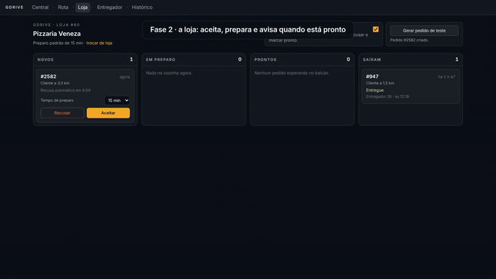
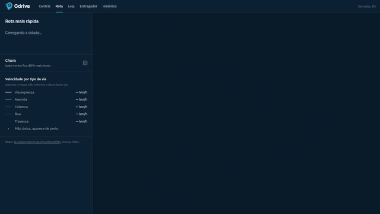

<h1>
  <picture>
    <source media="(prefers-color-scheme: dark)" srcset="docs/assets/logo-dark.svg" />
    
  </picture>
</h1>



Simulação de despacho de delivery sobre o mapa real de Salvador. Os entregadores andam pelas
ruas de verdade seguindo rotas de um roteador próprio, o despacho oferece cada pedido ao
entregador livre que chega mais rápido à loja, e cliente, loja e central acompanham tudo ao
vivo.

O objetivo é medir, com número, até onde o sistema escala na horizontal.

> **Estado:** fases 0 (mapa e roteador), 1 (núcleo do delivery) e 2 (operação) concluídas.
>
> **Navegador:** testado apenas no Chromium, no Linux. Google Chrome e outros navegadores não
> são testados.

## Rodar

```bash
docker compose up --build
```

| Endereço | O que mostra |
|---|---|
| <http://localhost:8085> | A central ao vivo: entregadores, um card por pedido na cor do status, alertas, chuva e pico |
| <http://localhost:8085/pedido/1> | O que o cliente vê: entregador no mapa, etapas e linha do tempo |
| <http://localhost:8085/loja> | Painel de uma loja: aceitar, recusar, marcar pronto, gerar pedido de teste |
| <http://localhost:8085/entregador> | O entregador pelo celular: oferta, piloto automático, coleta e entrega |
| <http://localhost:8085/historico> | Entregas feitas, com o replay do trajeto contra a rota prevista |
| <http://localhost:8085/rota> | A rota mais rápida entre dois cliques (fase 0) |

O compose sobe junto um simulador com 60 entregadores e um pedido novo a cada ~4 s, andando
8× mais rápido que o real. Para mudar: `SIM_COURIERS=200 SIM_ORDER_EVERY=1s SIM_SPEED=20
docker compose up -d sim`.

## Fase 2: a operação

**Quem opera.**

- **Loja** (`/loja`): os pedidos em colunas (novos, em preparo, prontos, saíram), aceite com
  tempo de preparo, recusa, "pronto" e um pedido de teste para um cliente sorteado entre 300 m
  e 4 km da loja pelo PostGIS. Loja operada na mão sai do piloto automático do simulador.
- **Entregador** (`/entregador`): tela de celular com a oferta e a contagem regressiva, piloto
  automático que anda pela rota real e manda a posição pelo mesmo WebSocket dos entregadores
  simulados, coleta e entrega. Desligar o piloto deixa o entregador parado, e a central percebe.
- **Central:** alertas ao vivo, reatribuição, chuva, pico e falhas simuladas por entregador.
- **Histórico** (`/historico`): cada entrega com o trajeto gravado e o replay contra a rota
  prevista.

**Alertas.** Um aberto por tipo e pedido (índice único parcial); abrir e fechar sai na outbox.
Só atraso e sem entregador entram na linha do tempo do cliente.

| Alerta | Quem detecta | Abre quando | Fecha quando |
|---|---|---|---|
| Sem sinal | worker, a cada 5 s | 20 s sem posição de um entregador com corrida | a posição volta, ele é desatribuído ou o pedido termina |
| Parado | engine | menos de 25 m de deslocamento em 30 s a caminho do destino | volta a andar ou chega |
| Fora da rota | engine | 3 posições seguidas a mais de 150 m da rota prevista | volta a menos de 60 m ou chega |
| Atrasado | worker, job no prazo | passou do horário prometido sem entregar | o pedido termina |
| Sem entregador | despacho | 2 min sem ninguém livre até 6 km | alguém é atribuído |

**Reatribuição.** Desatribuir devolve o pedido para "em preparo", libera o entregador e
recomeça o despacho sem ele. Atribuir na mão lista os entregadores livres e com sinal até
6 km, ordenados pelo tempo pelas ruas até a loja. O despacho também deixa de oferecer corrida
a quem está sem sinal.

**Simulação.** A chuva multiplica todo trajeto por 1,4 (rota, ETA e rota prevista); o pico
multiplica a chegada de pedidos. Por entregador: derrubar o sinal, parar no lugar ou desviar
(passa por um ponto a 700 m da linha reta e volta).

**Histórico.** Na entrega, um job grava cada trecho na tabela `tracks` como `LineStringM`
(M = instante da posição), com a rota prevista ao lado e a distância medida pelo PostGIS.

**Os testes que sustentam isso:**

- api e worker contra Postgres e Redis de verdade: desatribuir e o despacho oferecer a outro,
  atribuição na mão fechando o alerta, sinal perdido abrindo e fechando, despacho ignorando
  quem está sem sinal, parado e desvio vindos do rastreio, atraso no prazo, controles da
  simulação, painel da loja, dados do entregador e trajeto gravado na entrega.
- engine: parado dispara uma vez e avisa quando volta a andar, desvio só com 3 posições fora,
  distância até a rota, alerta entrando e saindo do retrato, chuva vinda do Redis.
- e2e no Chromium: entregador sem sinal vira alerta e a central libera o pedido; chuva e pico
  pelo painel; painel da loja; corrida completa pelo celular; replay do histórico.

## Fase 1: o núcleo do delivery


**A vida de um pedido.** O cliente pede de um dos 1.573 restaurantes reais. A loja aceita e
informa o preparo, e o despacho começa na hora: busca entregadores num raio de 2 km da loja,
descarta quem não está livre, pede ao roteador o tempo de cada um até a loja numa busca só e
oferece a corrida ao mais rápido. Ele tem 30 s; se recusar ou não responder, a oferta passa
ao próximo. Sem ninguém por perto, o raio cresce para 4 e depois 6 km. O entregador anda pela
rota real, a chegada na loja e no cliente é detectada pela posição (50 m), e a coleta só vale
com o pedido pronto.

**As peças.**

| Peça | O que faz |
|---|---|
| `api` (Python, FastAPI) | Pedidos, lojas, entregadores e ofertas. Toda mudança de status é um `UPDATE ... WHERE status = <esperado>` na mesma transação do evento e da outbox |
| `worker` (Python) | Jobs com `FOR UPDATE SKIP LOCKED` (despacho, oferta vencida, loja sem resposta), publica a outbox no Redis Streams e consome as chegadas detectadas pelo engine |
| `engine` (Go) | WebSocket dos entregadores, posição no Redis (GEO), chegada por geofence, ETA de N entregadores numa busca, estado ao vivo para a central e para o cliente |
| `sim` (Go) | 60 entregadores com um WebSocket real cada, lojas que aceitam e preparam, clientes que pedem de restaurantes próximos |
| PostgreSQL + PostGIS | Fonte da verdade: pedido, oferta, linha do tempo, outbox e jobs |
| Redis | Última posição, fan-out entre instâncias e os streams `events.orders` e `events.tracking` |

**O que garante que não se perde nada.**

- Mudança de estado e evento são gravados juntos (outbox): não existe pedido que mudou sem
  avisar, nem aviso de mudança que não aconteceu.
- Dois aceites simultâneos da mesma oferta: um ganha, o outro recebe 409.
- Um entregador tem no máximo um pedido ativo e uma oferta pendente (índices únicos parciais).
- Evento chega com a versão do pedido; quem consome ignora versão velha.
- Chegada que falhou no meio volta a ser processada (`XAUTOCLAIM` no consumer group).
- O simulador tenta de novo quando a api cai e, ao reiniciar, retoma os pedidos em andamento.

**Os testes que sustentam isso:**

- 16 testes da api e do worker contra Postgres e Redis de verdade: o pedido de ponta a ponta
  com a sequência exata de eventos, transição fora de ordem, aceite duplo, oferta vencida e
  recusada passando ao próximo, raio crescente com alerta de pedido sem entregador, loja que
  não responde, cancelamento, relay da outbox, chegada reprocessada, job que nunca roda duas
  vezes e a api sobrevivendo ao banco derrubar todas as conexões.
- Engine com Redis em memória: posição gravada, chegada disparada uma vez só, retrato da
  central, eventos e posição repassados a quem acompanha o pedido, estado reconstruído do
  histórico ao reiniciar.
- e2e no Chromium: a central com os contadores e um card `#id` por pedido, o acompanhamento ao
  vivo e o planejador de rota.
- Na CI, a pilha inteira sobe com o simulador acelerado e precisa entregar pedidos de ponta a
  ponta.

## Fase 0: mapa e roteador



**O mapa.** A malha viária de Salvador vem do OpenStreetMap, importada pelo `osmimport`:

| Salvador | |
|---|---|
| Nós | 156.589, dos quais 21.815 cruzamentos |
| Vias | 3.334 km em 23.994 vias, 7.139 de mão única, 163 rotatórias |
| Velocidade máxima no mapa | 2.162 vias; nas outras vale o padrão da classe |
| Lojas | 1.573 restaurantes, lanchonetes, cafés e sorveterias reais, presos ao nó mais próximo |
| Extensão | 24,8 × 24,8 km |

**O que a importação respeita:**

- Classe da via: `motorway` e `trunk` viram via expressa, `primary` avenida, `secondary` e
  `tertiary` coletora, `residential` rua, `living_street` travessa.
- Sentido: `oneway=yes`, `oneway=-1` (mão única contra o desenho da via), rotatória e
  `motorway` são mão única mesmo sem a tag.
- Acesso: via privada ou proibida para moto fica de fora.
- Velocidade: `maxspeed` quando existe; senão, o padrão da classe (expressa 80 km/h, avenida
  60, coletora 50, rua 40, travessa 30).

**Só o maior componente fortemente conexo.** Ilhas, pontas de mão única sem saída e erros de
mapeamento ficam de fora: 2.845 nós. Inverter uma mão única real para fechar a malha seria
mentir sobre a cidade, então quem sai é o pedaço desconectado.

**O roteador.** A* com peso em tempo, usando a velocidade de cada via, × fator de clima
(chuva = 1,4). A heurística é a distância em linha reta ÷ a maior velocidade da cidade, que
nunca superestima. Uma rota entre dois pontos aleatórios de Salvador leva **8,2 ms** em média
sobre os 156 mil nós (`go test -bench`).

Exemplo do GIF: da Barra até a Paralela são 17 min 11 s e 19,9 km, pela Av. Cardeal da Silva,
Av. Juracy Magalhães Júnior, Av. ACM e Av. Paralela.

Para o despacho da fase 1 já existe o Dijkstra de um para muitos: uma busca a partir da loja,
no grafo com as setas invertidas, devolve o tempo de N entregadores até ela.

**Os testes que sustentam isso:**

- A importação de um mapa de teste respeita sentido, `oneway=-1`, rotatória, acesso privado,
  `maxspeed` e descarta o que não é fortemente conexo.
- A loja vai para o cruzamento mais próximo; sem nome, longe demais ou bar ficam de fora.
- A* devolve o mesmo custo que Dijkstra em 1.000 grafos aleatórios com mão única, e em 400
  pares de pontos de Salvador.
- Em 200 rotas por Salvador, todo trecho respeita a mão única e o tempo acumulado bate.
- A Salvador versionada em `cities/salvador/` é fortemente conexa, fica dentro dos limites da
  cidade e é igual ao que a importação produz a partir da cópia local do OpenStreetMap.
- e2e no Chromium contra a pilha do `docker compose`: o mapa carrega, dois cliques traçam a
  rota com o nome das vias, a chuva deixa a rota mais lenta, clique no mar dá aviso.

## APIs

**api** (`/api`, pelo nginx):

| Rota | O que faz |
|---|---|
| `POST /api/orders` | `{"store_id":..,"address_id":..}` → pedido em `aguardando_loja` com o horário prometido |
| `GET /api/orders/{id}` | Pedido com loja, cliente, entregador e linha do tempo |
| `POST /api/orders/{id}/cancel` | Cancela até a coleta; depois, 409 |
| `POST /api/stores/{sid}/orders/{id}/accept` · `reject` · `ready` | Ações da loja |
| `POST /api/offers/{id}/accept` · `decline` | Resposta do entregador à oferta; aceite vencido dá 409 |
| `POST /api/orders/{id}/pickup` · `deliver` | Coleta (exige pedido pronto) e entrega |
| `POST /api/couriers/{id}/online` · `offline` | Turno do entregador (`{"human": true}` tira da simulação) |
| `GET /api/couriers/{id}` | Entregador com a oferta pendente e a corrida ativa |
| `GET /api/orders/{id}/candidates` | Entregadores livres e com sinal até 6 km, pelo tempo até a loja |
| `POST /api/orders/{id}/assign` · `unassign` | Atribuição e desatribuição pela central |
| `GET /api/alerts?open=true` | Alertas abertos ou todos |
| `GET /api/stores?q=` · `GET /api/stores/{id}` · `PUT /api/stores/{id}/manual` | Busca, dados e modo manual da loja |
| `GET /api/stores/{id}/orders` · `POST /api/stores/{id}/test-order` | Pedidos da loja e pedido de teste |
| `GET /api/history` · `GET /api/orders/{id}/track` | Entregas feitas e o trajeto gravado de cada uma |
| `GET` · `PUT /api/sim` · `POST /api/sim/couriers/{id}/{sem_sinal\|parar\|desviar}` | Chuva, pico e falhas simuladas |
| `GET /api/stats` | Pedidos por status, entregadores por status, entregues e tempo médio |

**engine:**

| Rota | O que faz |
|---|---|
| `GET /city` · `GET /city.geojson` | A cidade e todas as vias |
| `POST /route` | Rota mais rápida com tempo, distância, principais vias e tempo acumulado por nó |
| `POST /eta` | Tempo de N entregadores até um ponto, numa busca só (usado pelo despacho) |
| `WS /ws/courier?id=` | Posição do entregador, `{"lat":..,"lon":..}` |
| `WS /ws/watch/central` | Retrato da operação a cada 500 ms, com os alertas de cada pedido e a chuva |
| `GET /journey/{id}` | Rota prevista e posições de cada trecho de um pedido em andamento |
| `WS /ws/watch/order/{id}` | Eventos e posição do entregador de um pedido |

Origem e destino de rota são presos ao nó mais próximo, até 400 m. Mais longe que isso, a
resposta é `422 ponto fora da cidade`.

## Dados do mapa

Dados © colaboradores do OpenStreetMap, disponíveis sob a
[Open Database License (ODbL)](https://www.openstreetmap.org/copyright). O arquivo
`cities/salvador/city.gob.gz` é um banco de dados derivado e segue a mesma licença.

Para atualizar com a base mais recente:

```bash
cd engine
go run ./cmd/osmimport -refresh
```

O comando consulta a Overpass API, guarda a cópia bruta em `cities/salvador/osm-*.json` (fora
do git) e grava o `city.gob.gz`.

## Desenvolvimento

```bash
cd engine
go test ./...
```

```bash
docker compose -f deploy/compose.test.yml up -d
cd api
uv run pytest
```

```bash
cd web
pnpm install
pnpm dev
```

O front usa Node 24 (há um `mise.toml`) e, em desenvolvimento, encaminha `/api`, `/ws`,
`/city` e `/route` para a pilha do compose em `:8085`.

```bash
CHROMIUM_PATH=/usr/bin/chromium BASE_URL=http://localhost:8085 pnpm e2e
GIFS=../docs/assets CHROMIUM_PATH=/usr/bin/chromium pnpm video ../videos/2026-10-24-video-1-fases-0-a-2/gdrive-video-1.mp4
pnpm bench
```

## O sistema completo

| Parte | Tecnologia | Papel | Desde |
|---|---|---|---|
| `osmimport` | Go | Importa a malha e as lojas do OpenStreetMap | fase 0 |
| `engine` | Go | Roteador, WebSocket, posição, geofence; roda em N instâncias | fase 0 |
| `web` | React, TypeScript, MapLibre | Central, acompanhamento, loja, entregador, histórico, planejador de rota | fase 0 |
| `sim` | Go | Entregadores, lojas e clientes simulados, um WebSocket real por entregador | fase 1 |
| `api` e `worker` | Python, FastAPI | Pedidos, máquina de estados, despacho, prazos | fase 1 |
| Estado | PostgreSQL + PostGIS | Fonte da verdade; outbox e jobs na transação do pedido | fase 1 |
| Tempo real | Redis | Última posição, fan-out entre instâncias, Streams de eventos | fase 1 |
| Medição | Prometheus, Grafana, k6 | Escala horizontal com número | fase 3 |

## Fases

- [x] **0. Mapa e roteador:** Salvador real e página que traça a rota mais rápida entre dois
  cliques.
- [x] **1. Núcleo:** pedido de ponta a ponta, despacho com repasse e raio crescente,
  acompanhamento do cliente, mapa da central.
- [x] **2. Operação:** painel da loja, entregador pelo celular, alertas, reatribuição,
  histórico com replay, pico e chuva.
- [ ] **3. Escala:** várias instâncias, modo carga, métricas e teste de carga.
